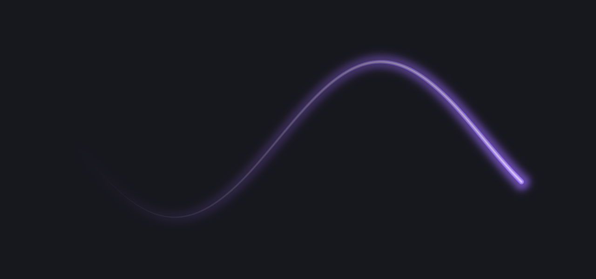

# Contrail

A glowing trail that follows your cursor on macOS. Free and open source.

Contrail draws a smooth, tapered neon trail behind the mouse pointer across every screen, which makes your cursor easy to follow in demos, lessons, and screen recordings. It lives in the menu bar, needs **no permissions**, and uses ~0% CPU when the cursor is still.



## Install

1. Download the latest `Contrail-x.y.z.dmg` from [Releases](https://github.com/Kiril-P/contrail/releases) and drag **Contrail** into **Applications**.
2. Open Contrail. Because the app isn't notarized yet, macOS says it can't verify it. Click **Done**.
3. Open **System Settings → Privacy & Security**, scroll down, and click **Open Anyway** next to the Contrail message. Confirm with your password or Touch ID, then click **Open**.

You only need to do this once. (On macOS 15 and later, Control-click → Open no longer skips this check.)

Requires macOS 13 Ventura or later, on Apple silicon or Intel.

## Use

Click the Contrail icon in the menu bar to turn the trail on or off, or quit.

## Build from source

You need Xcode 16 or later.

```sh
git clone https://github.com/Kiril-P/contrail.git
cd contrail
open Contrail.xcodeproj   # then press Run
```

Or from the command line:

```sh
(cd Packages/ContrailCore && swift test)   # unit tests for the trail model
scripts/build-release.sh                   # universal, ad-hoc signed .zip and .dmg in ./dist
```

### How it works

| Piece | Where |
| --- | --- |
| Trail model: time-based length, linger, smoothing (1€ filter), teleport detection | `Packages/ContrailCore/Sources/ContrailCore/TrailEngine.swift` |
| Geometry: centripetal Catmull–Rom spline → tapered capsules | `Packages/ContrailCore/Sources/ContrailCore/TrailGeometry.swift` |
| Rendering: one instanced Metal draw per screen; the fragment shader computes the core, anti-aliasing and glow from the exact distance to each capsule | `Contrail/Rendering/` |
| Overlays: one click-through panel per screen, above full-screen apps, visible in screen recordings | `Contrail/Overlay/` |

The trail samples `NSEvent.mouseLocation` once per display refresh. When the trail has faded, every display link pauses and only a mouse-moved monitor stays alive, so an idle cursor costs nothing.

The Metal shader is compiled at runtime from source, so you don't need Xcode's optional Metal toolchain download.

## Roadmap

- [x] **0.1**: menu-bar app and glowing trail on every screen
- [ ] **0.2**: customization (width, length, glow, taper, follow speed, linger), nine color presets, high-contrast matte mode for white backgrounds
- [ ] Letter gestures: draw a letter with the cursor to open apps, run Shortcuts, press keys, and more
- [ ] Sparks, auto-updates, Homebrew cask

## Contributing

Issues and pull requests are welcome. See [CONTRIBUTING.md](CONTRIBUTING.md).

## License

Contrail is free software under the [GNU General Public License v3.0](LICENSE).

The name "Contrail" and the Contrail icon are not covered by the license. If you distribute a modified version, please give it a different name and icon.
