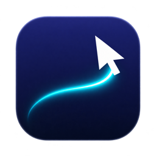
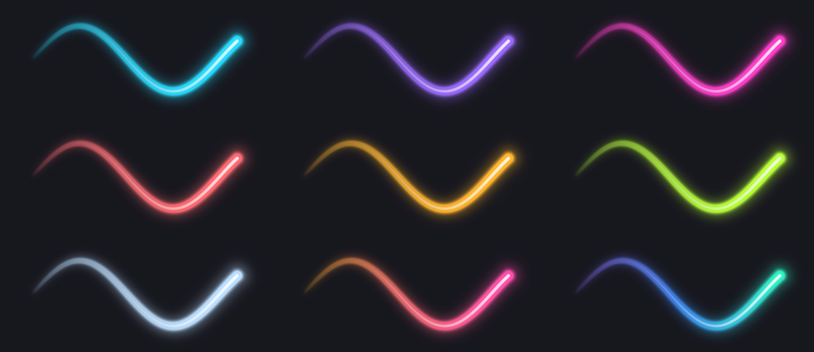
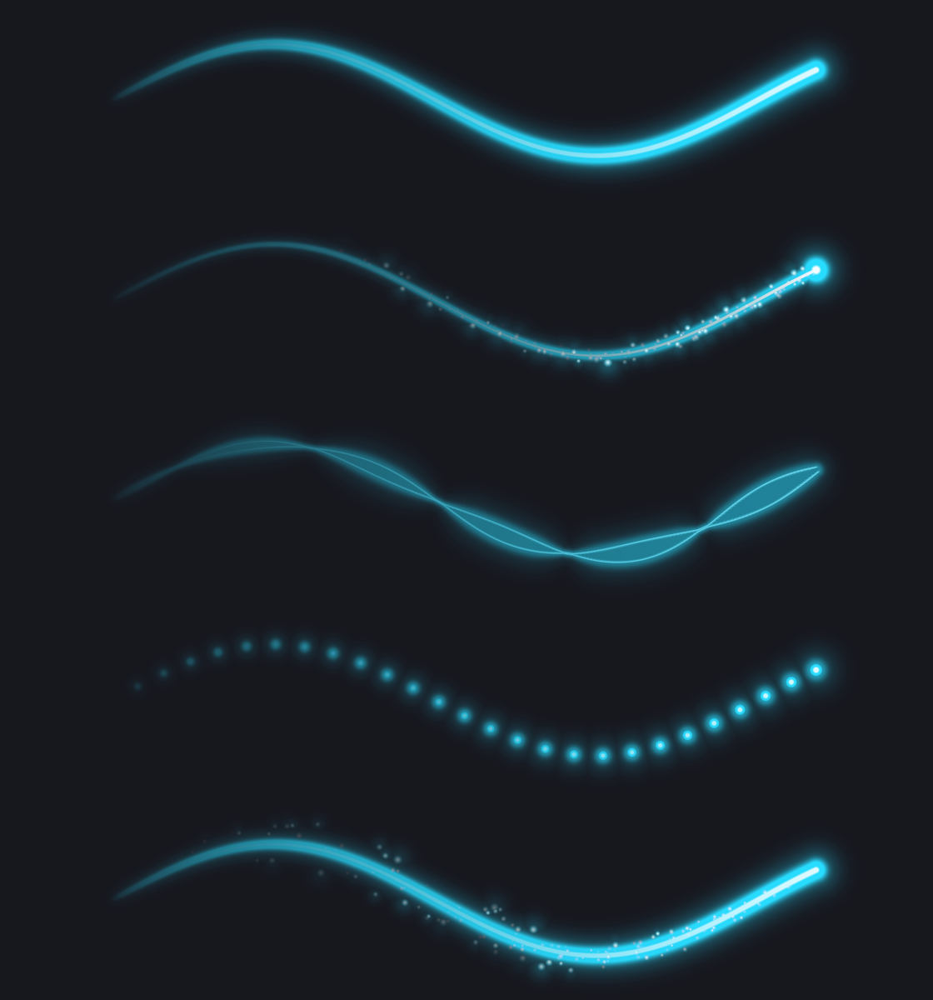
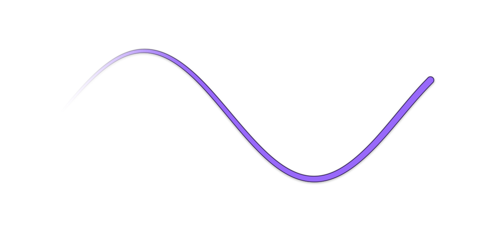
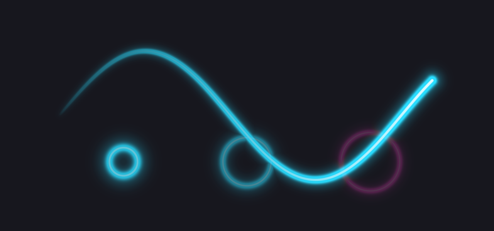

# Contrail

A glowing trail that follows your cursor on macOS. Free and open source.

Contrail draws a smooth, tapered neon trail behind the mouse pointer across every screen, which makes your cursor easy to follow in demos, lessons, and screen recordings. It lives in the menu bar, needs **no permissions**, and uses ~0% CPU when the cursor is still.






## Install

1. Download the latest `Contrail-x.y.z.dmg` from [Releases](https://github.com/Kiril-P/contrail/releases) and drag **Contrail** into **Applications**.
2. Open Contrail. Because the app isn't notarized yet, macOS says it can't verify it. Click **Done**.
3. Open **System Settings → Privacy & Security**, scroll down, and click **Open Anyway** next to the Contrail message. Confirm with your password or Touch ID, then click **Open**.

You only need to do this once. (On macOS 15 and later, Control-click → Open no longer skips this check.)

Requires macOS 13 Ventura or later, on Apple silicon or Intel.

## Use

Click the Contrail icon in the menu bar and pick a **Look**: six hand-tuned trails, each shown live.

| Look | What it is |
| --- | --- |
| Neon | A classic cyan neon tube (the default) |
| Aurora | A teal-to-violet ribbon |
| Comet | An amber head shedding dust |
| Sparkler | A sunset tube throwing sparks |
| Dots | Violet breadcrumbs that linger |
| Whisper | A thin, quiet line for recordings |

Choose **S / M / L** to size any Look for your screen or projector, and flip the quick toggles:

- **Click ripples**: an expanding ring wherever you click, great for screen recordings
- **High contrast**: a solid, outlined trail that stays readable on white documents and web pages





**Settings…** (⌘,) has everything else: color, style (Neon, Comet, Ribbon, Dotted, Sparks), width, length, glow, taper, opacity, sparks, ripple size and colors, follow and hold. Changing any of them turns your trail into a **Custom** look, and **Reset** takes you back to the Look it started from.

### Turning the trail on and off

- **Shortcut:** ⌃⌥T turns the trail on or off from anywhere. Change it in **Settings → Activation**.
- **Hold to show:** only draw while ⌥, ⌃, ⌘ or ⇧ is held, so the trail appears exactly when you want to point at something.
- **Per-app rules:** keep the trail always on in Keynote, or always off in a video player. A rule wins over the switch. Using the switch or shortcut in that app overrides the rule until you switch apps.
- **Games:** the trail turns off while an app that declares itself a game is in front.

None of this needs any permission. The shortcut uses the system hot-key API, and the hold key is read from mouse events Contrail already sees.

## Build from source

You need Xcode 26 or later.

```sh
git clone https://github.com/Kiril-P/contrail.git
cd contrail
open Contrail.xcodeproj   # then press Run
```

Or from the command line:

```sh
(cd Packages/ContrailCore && swift test)   # unit tests for the trail model
scripts/build-release.sh                   # universal, ad-hoc signed .zip and .dmg in ./dist
```

### How it works

| Piece | Where |
| --- | --- |
| Trail model: time-based length, linger, smoothing (1€ filter), teleport detection | `Packages/ContrailCore/Sources/ContrailCore/TrailEngine.swift` |
| Geometry: centripetal Catmull–Rom spline → tapered capsules | `Packages/ContrailCore/Sources/ContrailCore/TrailGeometry.swift` |
| Rendering: one instanced Metal draw per screen; the fragment shader computes the core, anti-aliasing and glow from the exact distance to each capsule | `Contrail/Rendering/` |
| Overlays: one click-through panel per screen, above full-screen apps, visible in screen recordings | `Contrail/Overlay/` |
| Menu-bar popover, Settings window, live preview | `Contrail/UI/` |

The trail samples `NSEvent.mouseLocation` once per display refresh. When the trail has faded, every display link pauses and only a mouse-moved monitor stays alive, so an idle cursor costs nothing.

The Metal shader is compiled at runtime from source, so you don't need Xcode's optional Metal toolchain download.

The app can also render the trail to a PNG without touching the cursor, which is handy for reviewing shader changes:

```sh
Contrail.app/Contents/MacOS/Contrail --snapshot out.png --preset sunset [--matte]
Contrail.app/Contents/MacOS/Contrail --snapshot-presets presets.png
```

## Roadmap

- [x] **0.1**: menu-bar app and glowing trail on every screen
- [x] **0.2**: customization (width, length, glow, taper, opacity, follow, hold), nine color presets, high-contrast mode for white backgrounds, live preview
- [ ] Letter gestures: draw a letter with the cursor to open apps, run Shortcuts, press keys, and more
- [x] **0.3**: click ripples, trail styles (Comet, Ribbon, Dotted, Sparks), toggle shortcut, hold-to-show, per-app rules
- [ ] Auto-updates, Homebrew cask

## Contributing

Issues and pull requests are welcome. See [CONTRIBUTING.md](CONTRIBUTING.md).

## License

Contrail is free software under the [GNU General Public License v3.0](LICENSE).

The name "Contrail" and the Contrail icon are not covered by the license. If you distribute a modified version, please give it a different name and icon.
